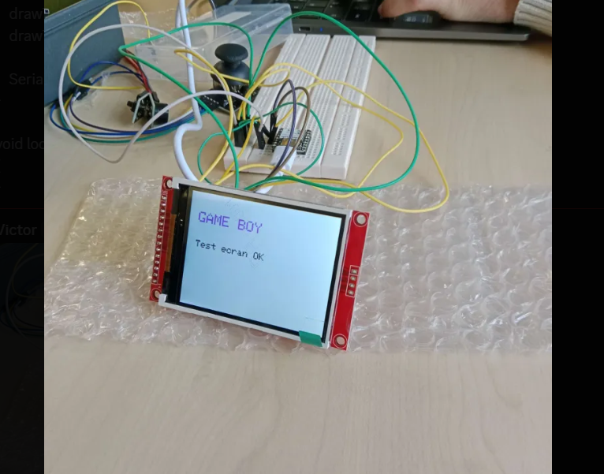

<!--
Modèle de séance, ce fichier n'apparaît pas sur le site (son nom commence par "_").
Copiez-le dans votre dossier, renommez la copie avec la date (ex. 2026-09-23.md), puis :
- title : la date et le sujet de la séance ;
- parent : EXACTEMENT le titre de votre page étudiant (docs/journal/votre-dossier/index.md).
-->

Objectif

Visualiser en temps réel des données envoyées par la XIAO ESP32S3 via le port série, avec PlatformIO et l'extension TelePlot.
Mise en place
• Carte XIAO ESP32S3 reliée au PC en USB-C (USB natif : aucun fil TX/RX à croiser).
• Dans platformio.ini : monitor_speed = 115200.
• Extension TelePlot installée dans VSCode.
Le code envoie un sinus et un cosinus. Une ligne préfixée par > est tracée comme une courbe, les autres vont dans le moniteur texte.

#include <Arduino.h>

float i = 0;

void teleplot(const char* label, float value)
{
  Serial.printf(">%s:%.3f\n", label, value);
}

void setup()
{
  Serial.begin(115200);
  delay(1500);   // USB natif : le port est rouvert après reset
}

void loop()
{
  i += 0.1;
  teleplot("sin", sin(i));
  teleplot("cos", cos(i));
  delay(10);
}
Résultat
Les courbes sin et cos s'affichent en temps réel, mises à jour toutes les 10 ms, et sont bien plus lisibles que le défilement du moniteur série.
[à compléter : capture d'écran de TelePlot]
Conclusion
TelePlot remplace avantageusement le moniteur série quand les données arrivent vite : il suffit de préfixer chaque ligne par >.

