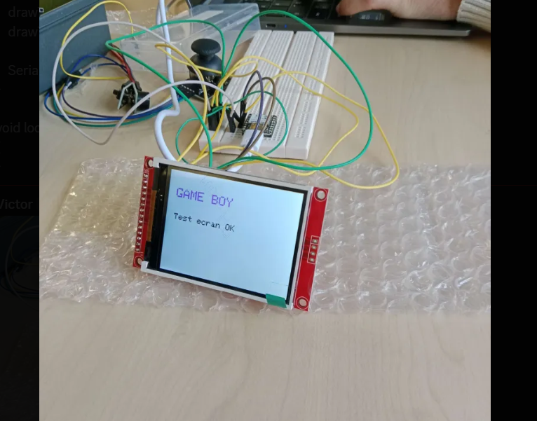

# 2026-11-19 : Boutons et joystick

Objectif

L'objectif de ce TP était de découvrir la gestion des entrées numériques et analogiques sur un microcontrôleur ESP32-S3. Pour cela, nous avons câblé deux boutons poussoirs ainsi qu'un joystick analogique, puis utilisé le moniteur série pour vérifier le bon fonctionnement des lectures.

Matériel utilisé
Carte XIAO ESP32-S3
Deux boutons poussoirs
Un joystick analogique (VRx, VRy, SW)
Breadboard
Câbles de connexion
PlatformIO sous VS Code
Câblage réalisé

Les boutons ont été reliés aux broches GPIO5 et GPIO6 en mode INPUT_PULLUP. Dans cette configuration, les boutons sont connectés à la masse (GND) et renvoient un état LOW lorsqu'ils sont pressés.

Le joystick a été câblé selon les recommandations du cours :

VRx → GPIO1 (ADC1)
VRy → GPIO2 (ADC1)
SW → GPIO7
VCC → 3,3 V
GND → GND
Lecture des boutons

Nous avons utilisé la fonction digitalRead() afin de détecter les appuis sur les boutons. Le mode INPUT_PULLUP simplifie le câblage puisqu'aucune résistance externe n'est nécessaire. Un léger anti-rebond a été ajouté afin d'éviter les déclenchements multiples lors d'un seul appui.

Les informations étaient affichées dans le moniteur série à 115200 bauds, permettant de vérifier immédiatement le bon fonctionnement des commandes.

Lecture du joystick

Contrairement aux boutons qui ne possèdent que deux états (HIGH ou LOW), le joystick fournit des valeurs analogiques lues grâce à l'ADC de l'ESP32-S3. Les valeurs retournées varient entre 0 et 4095 sur 12 bits.

Les mesures observées sont les suivantes :

Gauche / Bas : proche de 0
Centre : proche de 2048
Droite / Haut : proche de 4095

Les valeurs des axes X et Y ainsi que l'état du bouton intégré au joystick ont été affichés dans le moniteur série afin de vérifier le câblage et le fonctionnement du module.

Détection des directions

Une fonction de détection a ensuite été mise en place afin de transformer les valeurs analogiques en directions exploitables dans un jeu :

HAUT
BAS
GAUCHE
DROITE
CENTRE

Des seuils ont été utilisés pour définir une zone morte autour du centre du joystick afin d'éviter les faux déplacements lorsque celui-ci est relâché. Les seuils proposés sont de 1500 et 2500.

Résultats obtenus

Les boutons ont été correctement détectés et les messages correspondants ont été affichés dans le moniteur série. Le joystick a permis de récupérer les valeurs analogiques des axes X et Y ainsi que l'état du bouton intégré. Enfin, les différentes directions du joystick ont été reconnues avec succès grâce aux seuils définis autour de la position centrale.

Conclusion

Ce TP a permis de comprendre la différence entre les entrées numériques et analogiques, d'utiliser l'ADC de l'ESP32-S3 pour lire un joystick, et d'exploiter ces informations afin de détecter des directions utilisables dans un projet de jeu tel que Pong ou Snake. Le moniteur série s'est révélé être un outil essentiel pour le débogage et la validation du fonctionnement du matériel

<video controls src="video_20261119_110322 (2).mp4" title="Title"></video>
<video controls src="video_20261119_105004.mp4" title=""></video>
